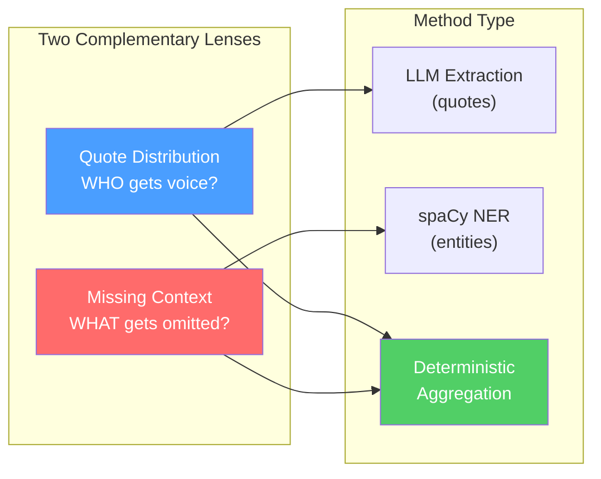

# Phase 5 Analysis: Quote Distribution + Missing Context

> Should you keep these criteria, drop them, or pick something else?

---

## 1. What Do These Actually Mean?

You planned these in [IDEA.md](file:///home/krish/Dev/neutral-news/IDEA.md#L30-L34) and [TODO.md](file:///home/krish/Dev/neutral-news/TODO.md#L142-L166) — let me reconstruct what you meant and make it concrete.

### Quote Distribution

**The question it answers:** *"Whose voice does each newspaper amplify?"*

Given an event covered by 3–4 outlets, you extract every direct/indirect quote from each article, classify the speaker into a role bucket (government official, opposition leader, expert/academic, citizen/witness, police, NGO), and then compare the proportions across outlets.

**Concrete example — "Farmers Protest" event, 3 articles:**

| Role | The Hindu | Indian Express | Times of India |
|---|---|---|---|
| Government | 2 (33%) | 5 (71%) | 4 (57%) |
| Opposition | 2 (33%) | 1 (14%) | 0 (0%) |
| Expert | 1 (17%) | 0 (0%) | 1 (14%) |
| Citizen | 1 (17%) | 1 (14%) | 2 (29%) |

**What this reveals:** ToI quoted zero opposition leaders. Indian Express gave 71% of voice to government. These are *facts*, not opinions — the user sees the numbers and draws their own conclusions. That's the "evidence explorer" philosophy from your vision.

**The pipeline for this:**
```
article full_text → LLM extracts (quote, speaker, role) → store in `quotes` table
    → for each event: aggregate quotes by role per article → output distribution
```

### Missing Context

**The question it answers:** *"What facts did this outlet leave out that everyone else reported?"*

For each event cluster, you look at the named entities (people, organizations, laws, places) extracted from each article. If an entity appears in 3 of 4 articles but is absent from one, that's a "missing context" signal.

**Concrete example — "Budget 2026" event, 4 articles:**

| Entity | Hindu | IE | ToI | NDTV |
|---|---|---|---|---|
| RBI Governor statement | ✓ | ✓ | ✗ | ✓ |
| Opposition walkout | ✓ | ✓ | ✓ | ✗ |
| NITI Aayog projections | ✗ | ✓ | ✓ | ✓ |

Output: 
- *"RBI Governor statement — mentioned by 3 of 4 sources, missing from Times of India"*
- *"NITI Aayog projections — mentioned by 3 of 4 sources, missing from The Hindu"*

**The pipeline for this:**
```
articles in event → fetch entities per article from `entities` table
    → set intersection/difference logic → flag entities in ≥ (N-1) but missing from ≤ 1
```

---

## 2. Should You Keep These? Critical Evaluation

### ✅ Arguments FOR Keeping (Quote Distribution)

| Reason | Why it matters |
|---|---|
| **It's the strongest "not an LLM wrapper" signal** | The extraction uses an LLM, but the *analysis* is pure counting and aggregation — deterministic, verifiable, reproducible. Interviewers can see you're not just prompting GPT and displaying the result. |
| **It's measurable and comparable** | Numbers per role per source → you can build bar charts, tables, heatmaps. This is what makes it *demoable*. |
| **It directly serves the project's thesis** | Your project asks "how is the same event portrayed differently?" — who gets quoted IS how events get portrayed differently. Media studies literature backs this: source selection is one of the most well-studied forms of editorial framing. |
| **It's resume-differentiating** | Structured information extraction + cross-document aggregation is a real NLP/IR problem. It shows you understand data pipelines beyond "call an API". |
| **Your DB schema already supports it** | The [`quotes`](file:///home/krish/Dev/neutral-news/src/neutral_news/db/schema.py#L66-L73) table (`quote_text`, `speaker`, `role`) is designed exactly for this. |

### ⚠️ Arguments AGAINST (Quote Distribution)

| Concern | Severity | Mitigation |
|---|---|---|
| **LLM quote extraction is noisy** | Medium | Indian English news has lots of indirect attribution ("sources said", "according to officials"). The LLM will miss some and hallucinate others. You'll need to validate a sample manually. But *imperfect extraction that's honest about its limitations* is still a valid demo. |
| **Role classification is ambiguous** | Medium | Is "BJP spokesperson" government or party? Is "retired judge" expert or former government? You need a clear taxonomy and accept some fuzz. Keep it to 5–6 buckets max. |
| **Some articles have zero quotes** | Low | Wire reports and short bulletins often don't quote anyone. Handle gracefully: "No direct quotes found in this article" is itself informative. |

### ✅ Arguments FOR Keeping (Missing Context)

| Reason | Why it matters |
|---|---|
| **It's almost free — you already have the data** | Your [`entities.py`](file:///home/krish/Dev/neutral-news/src/neutral_news/extract/entities.py) already extracts and stores entities. Missing context is literally set difference operations on data you've already computed. |
| **It's the most intuitive output for users** | "Article X didn't mention the Supreme Court ruling that 3 other sources discussed" is immediately understandable. No explanation needed. |
| **It's fully deterministic** | No LLM involved in the analysis. Entity extraction uses spaCy (already built), comparison is set math. This is the purest "not an LLM wrapper" component in your entire project. |
| **It pairs perfectly with quote distribution** | Quotes answer "whose voice is amplified?" Missing context answers "what information is omitted?" Together they cover the two most important editorial choices. |

### ⚠️ Arguments AGAINST (Missing Context)

| Concern | Severity | Mitigation |
|---|---|---|
| **Entity matching is fuzzy** | Medium-High | "Supreme Court" vs "SC" vs "apex court" — spaCy will extract these as different entities. You need entity normalization/deduplication (exact match won't cut it). This is solvable but not trivial. |
| **False positives from NER noise** | Medium | spaCy will extract some garbage entities. A "missing" entity might just be a NER error. You could add a minimum-confidence threshold or require entities to appear in ≥ 2 sources before flagging absence. |
| **Entities ≠ "context"** | Medium | An article can mention "Supreme Court" in passing without providing any actual context about the ruling. Entity presence/absence is a proxy, not the real thing. Be honest about this limitation. |

---

## 3. Verdict: Keep Both

**Quote Distribution + Missing Context is the right choice for V1.** Here's why this specific pairing works:



1. **They complement each other** — one analyses voices (who speaks), the other analyses facts (what's said/unsaid). Two orthogonal editorial choices.
2. **They use different extraction methods** — LLM for quotes, spaCy for entities. This demonstrates range in your technical toolkit.
3. **Both feed into deterministic analysis** — the interesting part (comparison) is pure data manipulation, not LLM prompting.
4. **Missing context is almost free** — entities are already extracted and stored. The "analysis" module for it is ~50 lines of set logic.
5. **Together they produce a compelling demo** — side-by-side articles with "this source quoted 0 opposition leaders" AND "this source omitted the Supreme Court ruling" is genuinely useful and visually strong.

---

## 4. Other Dimensions Considered (and Why to Defer)

| Alternative Dimension | Why it's tempting | Why defer to V2 |
|---|---|---|
| **Sentiment / Emotional Framing** | Feels like a "bias detector" feature | Sentiment analysis on Indian English news is unreliable without fine-tuning. "Controversial" might be factual, not emotional. Also risks turning the tool into the "bias score" thing you explicitly want to avoid. |
| **Headline Framing** | Easy to implement (just compare headlines) | Headlines alone are shallow — the interesting comparison is in the article body. Also, you already surface headlines in the UI. Adding a "headline comparison" module feels thin for a resume. |
| **Topic/Focus Classification** | Shows what each outlet emphasizes (economy vs politics) | Requires a topic taxonomy, a classifier, and handling multi-topic articles. Significant scope for a V1 that's supposed to ship in 2–4 weeks. Better as a V2 feature. |
| **Source Diversity Score** | How many independent viewpoints per article | This is a subset of quote distribution — if you have speaker roles, you can derive source diversity as a secondary metric. No need for a separate module. |

> [!TIP]
> **Source Diversity** could be a very lightweight addition after you finish Quote Distribution. It's just `count(distinct role)` per article — one extra line of aggregation, and it gives you a third metric for free.

---

## 5. Conceptual Mental Model

Think of the entire pipeline as three layers, each doing something fundamentally different:

```
┌─────────────────────────────────────────────────────────────┐
│ Layer 1: COLLECTION            (what enters the system)     │
│ RSS → Scrape → Clean text                                   │
│ Technical challenge: web scraping, deduplication             │
│ YOU ARE HERE: ✅ Done                                       │
├─────────────────────────────────────────────────────────────┤
│ Layer 2: STRUCTURING           (turning text into data)     │
│ Entities (spaCy) → Quotes (LLM) → Embeddings → Clusters    │
│ Technical challenge: NLP extraction, information retrieval   │
│ YOU ARE HERE: 🔨 ~80% done (quotes + event persist remain) │
├─────────────────────────────────────────────────────────────┤
│ Layer 3: CROSS-DOCUMENT ANALYSIS  (the actual insight)      │
│ Quote distribution → Missing context → LLM narration        │
│ Technical challenge: comparative reasoning over structured   │
│ data from multiple documents about the same event            │
│ YOU ARE HERE: ❌ Not started ← THIS IS PHASE 5             │
└─────────────────────────────────────────────────────────────┘
```

**Layer 3 is where the project becomes interesting.** Layers 1 and 2 are infrastructure — necessary but not differentiating. The analysis layer is what makes this "not just another scraper" or "not just another LLM wrapper."

> [!IMPORTANT]
> **The key insight for interviews:** Every individual component (RSS parsing, web scraping, NER, embeddings, clustering) is a solved problem with existing libraries. What's NOT solved is *combining outputs from multiple NLP pipelines across multiple documents about the same event to surface editorial differences*. That cross-document comparative analysis is the novel part — and it's what Phase 5 builds.

---

## 6. Readiness Audit: Do You Have Everything to Start Phase 5?

### What's Ready ✅

| Dependency | Status | Location |
|---|---|---|
| Event clusters exist | ✅ Algorithm works | [`cluster.py`](file:///home/krish/Dev/neutral-news/src/neutral_news/embed/cluster.py) — HAC with complete linkage, medoid computation |
| Distance matrix | ✅ Built | [`distance.py`](file:///home/krish/Dev/neutral-news/src/neutral_news/embed/distance.py) — 3-factor weighted distance |
| Entity extraction | ✅ Working | [`entities.py`](file:///home/krish/Dev/neutral-news/src/neutral_news/extract/entities.py) — spaCy NER, stored in `entities` table |
| DB schema for quotes | ✅ Created | [`schema.py`](file:///home/krish/Dev/neutral-news/src/neutral_news/db/schema.py#L66-L73) — `quotes(quote_text, speaker, role)` |
| DB schema for events | ✅ Created | [`schema.py`](file:///home/krish/Dev/neutral-news/src/neutral_news/db/schema.py#L89-L101) — `events` + `event_articles` |
| DB schema for explanations | ✅ Created | [`schema.py`](file:///home/krish/Dev/neutral-news/src/neutral_news/db/schema.py#L104-L110) — `event_explanations` with JSONB evidence |

### What's Blocking ❌ — Must Finish First

| Blocker | Why it blocks Phase 5 | Effort |
|---|---|---|
| **Quote extraction (`extract/quotes.py`)** | Quote distribution analysis needs quotes in the DB. No quotes → nothing to count. | **Medium** — design LLM prompt, implement extraction, store results. This is your Phase 3 remaining work. |
| **Event persistence (`embed/group_events.py`)** | Analysis works *per event*. Without persisted events in the `events` + `event_articles` tables, you can't ask "for event X, give me all articles." | **Small** — the clustering algorithm works; you just need to write the results to DB. |
| **Wiring entity extraction into pipeline** | Currently `make extract` is a standalone command. Needs to run automatically after scraping so entities are always available. | **Tiny** — one function call in [`pipeline.py`](file:///home/krish/Dev/neutral-news/src/neutral_news/pipeline.py#L63-L84). |

### What Would Be Nice But Won't Block You ⚡

| Nice-to-have | Impact if skipped |
|---|---|
| Entity normalization ("SC" = "Supreme Court") | Missing context will have false positives. Acceptable for V1; note it as a known limitation. |
| Non-linear time distance scaling | Clustering quality might suffer for multi-day events. Acceptable for V1 demo. |
| Incremental event updates | New articles can't join existing events. Acceptable: just re-cluster from scratch for now. |

---

## 7. Suggested Execution Order

```
Step 1 ─── Quote Extraction (Phase 3 remaining)
            Write extract/quotes.py
            Design LLM prompt, implement extraction, test on sample articles
            ↓
Step 2 ─── Event Persistence (Phase 4 remaining)  
            Write embed/group_events.py (or persist_events())
            Insert events + event_articles into DB after clustering
            Wire into pipeline.py
            ↓
Step 3 ─── Missing Context Analysis (easiest win)
            Write analyze/missing_context.py
            ~50 lines: fetch entities per event, set difference, flag gaps
            ↓
Step 4 ─── Quote Distribution Analysis
            Write analyze/quote_distribution.py
            Aggregate quotes by role per article per event
            ↓
Step 5 ─── Analysis Orchestrator
            Write analyze/analyze_event.py
            Calls both, returns combined structured evidence
            ↓
Step 6 ─── LLM Explanation (Phase 6)
            Takes structured evidence → human-readable narrative
```

> [!NOTE]
> **Steps 1 and 2 are parallelizable** — quote extraction and event persistence have no dependency on each other. You can work on either first. But both must be done before Step 3/4.

---

## 8. What This Looks Like on a Resume

With these two dimensions implemented, you can honestly claim:

> **Media Lens** — Explainable news comparison platform  
> - Built an end-to-end NLP pipeline processing articles from 3+ Indian English outlets via RSS feeds  
> - Implemented event detection using Hierarchical Agglomerative Clustering on a composite distance metric (semantic embeddings, publication time, named entity overlap)  
> - Designed cross-document analysis: quote attribution extraction (LLM), speaker role distribution, and missing context detection (spaCy NER + set-theoretic comparison)  
> - LLM used only as final explanation layer over pre-computed structured evidence — not as the core analysis engine  
> - Tech: Python, PostgreSQL + pgvector, spaCy, sentence-transformers, HAC, FastAPI

Every bullet point in that description maps to real code you've written and can walk through. That's the goal.
