# System Data Flow

```mermaid
flowchart LR
    subgraph INGEST["1. RSS Ingest & Parse"]
        RSS["RSS Feeds<br/>(multiple sources)"]
        PARSE["Poll & Parse RSS Items"]
    end

    subgraph DB_STAGE["2. Database Staging"]
        DB1[("articles table<br/>status: 'pending' → 'completed'")]
    end

    subgraph SCRAPE_STAGE["3. Async Scraper Worker"]
        SCRAPE["Fetch Full Text Web Page"]
    end

    subgraph EXTRACT["4. Extract"]
        ENT["Extract entities"]
        QUOTES["Extract quotes"]
    end

    subgraph EMBED["5. Embed & Group"]
        EMB["Generate embeddings"]
        DB2[("article_embeddings table")]
        GROUP["Group into events"]
        DB3[("events & event_articles tables")]
    end

    subgraph ANALYZE["6. Analyze"]
        MISS["Find missing context"]
        BIAS["Find quote distribution"]
    end

    subgraph LLM["7. Explain"]
        EXPL["LLM explanation layer"]
        DB4[("event_explanations table")]
    end

    UI["Frontend"]

    RSS -- "Fetch XML feed" --> PARSE
    PARSE -- "INSERT metadata into DB<br/>(status = 'pending')<br/>ON CONFLICT DO NOTHING" --> DB1

    DB1 -- "SELECT articles<br/>WHERE status = 'pending'" --> SCRAPE
    SCRAPE -- "UPDATE articles SET<br/>full_text = '...',<br/>status = 'completed'" --> DB1

    DB1 -- "article_id, full_text" --> ENT
    DB1 -- "article_id, full_text" --> QUOTES
    DB1 -- "article_id, headline, text" --> EMB

    EMB -- "article_id, embedding" --> DB2
    DB2 -- "article_id, embedding" --> GROUP
    GROUP -- "event_id, article_id[]" --> DB3

    DB3 -- "event_id, article_id[]" --> MISS
    DB3 -- "event_id, article_id[]" --> BIAS
    QUOTES -- "article_id, (quote, speaker, role)[]" --> BIAS

    MISS -- "missing_topics_list" --> EXPL
    BIAS -- "quote_distribution_counts" --> EXPL
    EXPL -- "event_id, explanation_text, evidence" --> DB4
    DB4 -- "event_id, explanation_text, evidence" --> UI
```

## Data Movement Detail

| From → To | What actually moves |
|---|---|
| RSS feed → Poll & Parse RSS Items | `article_url`, `headline`, `source_name`, `published_at` |
| Poll & Parse RSS Items → `articles` table | `INSERT INTO articles` (`status = 'pending'`, `ON CONFLICT DO NOTHING`) |
| `articles` table → Async Scraper Worker | `SELECT WHERE status = 'pending'` (`article_id`, `article_url`) |
| Async Scraper Worker → Update `articles` | `UPDATE articles` (`full_text`, `scraped_at`, `status = 'completed'`) |
| Store raw (`articles`) → Extract entities/quotes | `article_id`, `full_text` |
| Store raw (`articles`) → Generate embeddings | `article_id`, `headline`, `full_text` |
| Generate embeddings → Group into events | `article_id`, `embedding_vector` |
| Group into events → Analyze | `event_id`, list of `article_id`s in that group |
| Extract (quotes) → Analyze | `article_id`, list of `(quote_text, speaker, role)` |
| Analyze → LLM explanation | `event_id`, `quote_distribution_counts`, `missing_topics_list` |
| LLM explanation → Frontend | `event_id`, `explanation_text`, underlying evidence (counts, missing list) |

